# A4

A clean, elegant web browser with classic book typography and a paper-like aesthetic. Built with Electron for full browser functionality.

## Download

Get the latest version from the **[Releases page](https://github.com/smiazon/a4/releases/latest)**:

| System | File |
|---|---|
| Mac with Apple silicon (M1 and later) | `A4-…-mac-arm64.dmg` |
| Mac with Intel | `A4-…-mac-x64.dmg` |
| Windows 10/11 | `A4-…-windows-setup.exe` |
| Linux | `A4-…-linux-x86_64.AppImage` |

A4 isn't signed with an Apple or Microsoft developer certificate yet, so the first launch needs one extra step:

- **macOS**: open the .dmg and drag A4 to Applications. The first time you open it, macOS says it can't verify the developer. Click **Done**, then go to **System Settings → Privacy & Security**, scroll down and click **Open Anyway** next to A4.
- **Windows**: if SmartScreen says "Windows protected your PC", click **More info → Run anyway**.
- **Linux**: make the file executable (`chmod +x A4-*.AppImage`) and run it.

## Features

- **Paper & ink design**: warm Kindle-like paper, night mode with one switch, serif typography (Crimson Text, Cormorant Garamond, EB Garamond)
- **Art new tab page**: a slow slideshow of famous public-domain paintings with a clock, search and a museum-style label (click it to read about the painting). Switch to the **Classic** page (daily line + shortcuts) in Settings
- **Ask AI** (`⌘K` or the orb, top-left): a quick assistant that works with Claude, ChatGPT or Gemini using your own API key (encrypted in the macOS keychain, used only by the app's main process). It can read the page you're on when you allow it
- **Shields**: blocks ads & trackers (Ghostery engine, EasyList/EasyPrivacy), pop-ups without a click, upgrades http to https, sends Global Privacy Control, and uses secure DNS. The shield in the address bar shows what was blocked and turns shields off per site
- **VPN & proxy**: route private windows (or everything) through your own VPN provider's SOCKS5/HTTP proxy or Tor. If it's unreachable, pages fail instead of leaking
- **Focus mode** (`⇧⌘F`): tabs and toolbar step aside; move to the top edge to bring them back. On the art page it shows the whole painting with a quiet caption: title, artist and year
- **Bookmarks bar** (`⇧⌘B`): bookmarks and folders under the address bar. Drag to reorder or drop onto a folder, drag in a tab or a link from any page, click a folder to open its list (or all of it in tabs), right-click to rename or delete. ★ asks where to save
- **Mail avatar**: sign in to Gmail, Outlook, iCloud, Yahoo, Proton or any webmail from the top-right of the new tab page (sign-in happens on the provider's own page; Google's sign-in pages see A4 as Firefox, because Google refuses browsers built on Electron). Your avatar then sits beside `⋮` on every tab, with an unread count, and opens your inbox
- **Address completion**: A4 remembers addresses you type. Start typing ("you…") and the rest appears faintly; press Tab to take it or Enter to go. Searches aren't remembered, private windows add nothing, and clearing history forgets them
- **Reading mode**: the book icon in the address bar turns articles into a clean, adjustable-size reading view
- **Chrome-like browsing**: tabs, back/forward, reload/stop, find in page, zoom, bookmarks (★ or `⌘D`) and folders, history, downloads, private windows, extensions
- **Small details**: rainbow sweep on search, frosted-glass menus, a page that sits on the paper like a sheet

## Getting Started

### Installation

```bash
npm install
```

### Development

For web development (with iframe limitations):
```bash
npm run dev
```

For Electron development (full browser):
```bash
npm run electron:dev
```

On macOS this opens Electron through `open` (see `scripts/start-electron.js`) so it is its own app for privacy checks. Run directly from a terminal or editor, macOS checks that app's permissions instead and kills Electron when a sign-in page reaches for Bluetooth for passkeys.

This will start the Vite dev server and launch the Electron app.

### Build

Build for production:
```bash
npm run electron:build
```

This will create distributable packages for your platform (DMG on macOS, NSIS installer on Windows, AppImage on Linux) in `dist-electron/`.

### Releasing

GitHub Actions builds every platform and publishes a release when you push a version tag. Bump `version` in `package.json`, commit, then:
```bash
git tag v1.0.1 && git push origin v1.0.1
```

The app icon is drawn by `scripts/make-icons.js` (`npx electron scripts/make-icons.js` rewrites everything in `build/`).

## Keyboard Shortcuts

Shortcuts live in the app menu (`electron/main.js`), so they work even while a web page has focus. On Windows/Linux use `Ctrl` for `⌘`.

| Action | Shortcut |
|---|---|
| New tab / window / private window | `⌘T` / `⌘N` / `⇧⌘N` |
| Ask AI | `⌘K` |
| Focus mode | `⇧⌘F` (Esc to leave) |
| Close tab / reopen closed tab | `⌘W` / `⇧⌘T` |
| Next / previous tab | `⌃Tab` / `⌃⇧Tab` (or `⌥⌘→` / `⌥⌘←`) |
| Go to tab 1–8 / last tab | `⌘1`–`⌘8` / `⌘9` |
| Focus address bar | `⌘L` |
| Back / forward / home | `⌘[` / `⌘]` / `⇧⌘H` |
| Reload / force reload / stop | `⌘R` / `⇧⌘R` / `⌘.` |
| Find / next / previous | `⌘F` / `⌘G` / `⇧⌘G` |
| Zoom in / out / reset | `⌘=` / `⌘-` / `⌘0` |
| Bookmark this page / all bookmarks | `⌘D` / `⌥⌘B` |
| Show / hide bookmarks bar | `⇧⌘B` |
| History / downloads / settings | `⌘Y` / `⌥⌘L` / `⌘,` |
| Save page / print | `⌘S` / `⌘P` |
| Developer tools | `⌥⌘I` |

## Mouse Interactions

- Middle-click tab - Close tab
- Drag and drop - Reorder tabs
- Right-click tab - New tab to the right, reload, duplicate, close, close others, close tabs to the right
- Right-click page - Link, image, text and page actions (open in new tab/window, save, copy, search, inspect…)
- Star in the address bar - Bookmark the page and choose its folder (click again to edit or remove)
- Bookmarks bar - Drag to reorder or into folders; drop tabs or links from pages; `+` makes a folder; right-click to rename, move or delete
- Mail avatar - Opens your inbox; the caret (or right-click) lists accounts, adds another or removes one
- Book icon in the address bar - Reading mode
- `⋮` menu - New tab/window/private window, focus, dark mode switch, zoom, history, bookmarks, downloads, settings
- A4 orb (top left) - Ask AI
- Back from a page you opened from the new tab page - returns to it (same painting)
- Painting label on the new tab page - Read about the painting; `←` / `→` flip paintings

## Technology Stack

- React 18
- Electron 28
- Vite
- Modern CSS with custom properties
- Classic serif fonts from Google Fonts

## Design Philosophy

Smiazon combines modern web browsing with the timeless elegance of classic typography. The interface features:

- **Boxy, minimal chrome**: Sharp corners, clean lines, maximum screen real estate
- **Serif typography**: Classic book fonts for a refined reading experience
- **Warm paper tones**: Beige and cream colors with subtle texture
- **Lightweight interactions**: Fast, simple transitions
